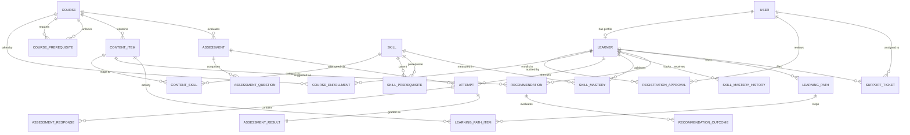

# Database Schema Documentation
## Personalized Learning Recommendation System

### 1. Entity-Relationship Diagram (ERD)

---

### 2. Table Specifications

#### 1. `learning_system_user` (Base User & RBAC)
- `id`: BIGINT AUTO_INCREMENT PRIMARY KEY
- `username`: VARCHAR(150) UNIQUE NOT NULL
- `email`: VARCHAR(254) NOT NULL
- `password`: VARCHAR(128) NOT NULL (Argon2 / PBKDF2 hashed)
- `role`: VARCHAR(20) NOT NULL (`LEARNER`, `INSTRUCTOR`, `ACADEMIC_ADMIN`, `SUPPORT_STAFF`, `PLATFORM_ADMIN`)
- `status`: VARCHAR(20) NOT NULL (`PENDING`, `ACTIVE`, `REJECTED`, `SUSPENDED`)
- `phone_number`: VARCHAR(20) NULL
- `created_at`: DATETIME(6) NOT NULL
- `updated_at`: DATETIME(6) NOT NULL

#### 2. `learning_system_learner`
- `learner_id`: VARCHAR(20) PRIMARY KEY (`LRN-000001`)
- `user_id`: BIGINT UNIQUE FK -> `learning_system_user.id` (CASCADE)
- `current_education_level`: VARCHAR(50) NOT NULL
- `learning_goals`: LONGTEXT NOT NULL
- `total_completed_activities`: INT UNSIGNED NOT NULL DEFAULT 0
- `created_at`: DATETIME(6) NOT NULL

#### 3. `learning_system_registrationapproval`
- `approval_id`: VARCHAR(20) PRIMARY KEY (`APR-000001`)
- `learner_id`: VARCHAR(20) FK -> `learning_system_learner.learner_id` (CASCADE)
- `reviewed_by_id`: BIGINT NULL FK -> `learning_system_user.id` (SET_NULL)
- `decision`: VARCHAR(15) NOT NULL (`APPROVED`, `REJECTED`)
- `reason`: LONGTEXT NOT NULL
- `created_at`: DATETIME(6) NOT NULL

#### 4. `learning_system_course`
- `course_id`: VARCHAR(20) PRIMARY KEY (`CRS-000001`)
- `title`: VARCHAR(200) NOT NULL
- `code`: VARCHAR(50) UNIQUE NOT NULL
- `description`: LONGTEXT NOT NULL
- `difficulty`: VARCHAR(15) NOT NULL (`BEGINNER`, `INTERMEDIATE`, `ADVANCED`)
- `is_advanced`: TINYINT(1) NOT NULL DEFAULT 0
- `created_by_id`: BIGINT NULL FK -> `learning_system_user.id` (SET_NULL)
- `is_active`: TINYINT(1) NOT NULL DEFAULT 1
- `created_at`: DATETIME(6) NOT NULL

#### 5. `learning_system_courseprerequisite`
- `id`: BIGINT AUTO_INCREMENT PRIMARY KEY
- `course_id`: VARCHAR(20) FK -> `learning_system_course.course_id` (CASCADE)
- `prerequisite_course_id`: VARCHAR(20) FK -> `learning_system_course.course_id` (CASCADE)
- `required_min_mastery`: DOUBLE NOT NULL DEFAULT 70.0
- `required_assessment_id`: VARCHAR(20) NULL FK -> `learning_system_assessment.assessment_id` (SET_NULL)
- `min_score`: DOUBLE NOT NULL DEFAULT 70.0
- **Constraint**: `UNIQUE KEY (course_id, prerequisite_course_id)`

#### 6. `learning_system_skill`
- `skill_id`: VARCHAR(20) PRIMARY KEY (`SKL-000001`)
- `name`: VARCHAR(150) UNIQUE NOT NULL
- `code`: VARCHAR(50) UNIQUE NOT NULL
- `category`: VARCHAR(100) NOT NULL
- `description`: LONGTEXT NOT NULL

#### 7. `learning_system_skillprerequisite` (DAG)
- `id`: BIGINT AUTO_INCREMENT PRIMARY KEY
- `parent_skill_id`: VARCHAR(20) FK -> `learning_system_skill.skill_id` (CASCADE)
- `prerequisite_skill_id`: VARCHAR(20) FK -> `learning_system_skill.skill_id` (CASCADE)
- `required_mastery_level`: DOUBLE NOT NULL DEFAULT 70.0
- **Constraint**: `UNIQUE KEY (parent_skill_id, prerequisite_skill_id)`

#### 8. `learning_system_contentitem`
- `content_id`: VARCHAR(20) PRIMARY KEY (`CNT-000001`)
- `course_id`: VARCHAR(20) FK -> `learning_system_course.course_id` (CASCADE)
- `title`: VARCHAR(250) NOT NULL
- `format`: VARCHAR(15) NOT NULL (`VIDEO`, `ARTICLE`, `EXERCISE`, `QUIZ`)
- `difficulty`: VARCHAR(15) NOT NULL (`BEGINNER`, `INTERMEDIATE`, `ADVANCED`)
- `estimated_minutes`: INT UNSIGNED NOT NULL DEFAULT 15
- `content_body`: LONGTEXT NOT NULL
- `order`: INT UNSIGNED NOT NULL DEFAULT 1
- `is_active`: TINYINT(1) NOT NULL DEFAULT 1

#### 9. `learning_system_contentskill` (Bridge Table)
- `id`: BIGINT AUTO_INCREMENT PRIMARY KEY
- `content_item_id`: VARCHAR(20) FK -> `learning_system_contentitem.content_id` (CASCADE)
- `skill_id`: VARCHAR(20) FK -> `learning_system_skill.skill_id` (CASCADE)
- `relevance_weight`: DOUBLE NOT NULL DEFAULT 1.0
- **Constraint**: `UNIQUE KEY (content_item_id, skill_id)`

#### 10. `learning_system_attempt`
- `attempt_id`: VARCHAR(50) PRIMARY KEY (`ATT-<learner_id>-000001`)
- `learner_id`: VARCHAR(20) FK -> `learning_system_learner.learner_id` (CASCADE)
- `assessment_id`: VARCHAR(20) FK -> `learning_system_assessment.assessment_id` (CASCADE)
- `content_item_id`: VARCHAR(20) NULL FK -> `learning_system_contentitem.content_id` (SET_NULL)
- `attempt_number`: INT UNSIGNED NOT NULL DEFAULT 1
- `score`: DOUBLE NOT NULL DEFAULT 0.0
- `max_score`: DOUBLE NOT NULL DEFAULT 100.0
- `percentage`: DOUBLE NOT NULL DEFAULT 0.0
- `passed`: TINYINT(1) NOT NULL DEFAULT 0
- `is_valid`: TINYINT(1) NOT NULL DEFAULT 1
- `started_at`: DATETIME(6) NOT NULL
- `completed_at`: DATETIME(6) NOT NULL

#### 11. `learning_system_assessmentresult`
- `id`: BIGINT AUTO_INCREMENT PRIMARY KEY
- `attempt_id`: VARCHAR(50) UNIQUE FK -> `learning_system_attempt.attempt_id` (CASCADE)
- `total_questions`: INT UNSIGNED NOT NULL
- `correct_answers`: INT UNSIGNED NOT NULL
- `score_percentage`: DOUBLE NOT NULL
- `passed`: TINYINT(1) NOT NULL
- `feedback`: LONGTEXT NOT NULL
- `computed_mastery_impact`: JSON NOT NULL
- `created_at`: DATETIME(6) NOT NULL

#### 12. `learning_system_skillmastery`
- `id`: BIGINT AUTO_INCREMENT PRIMARY KEY
- `learner_id`: VARCHAR(20) FK -> `learning_system_learner.learner_id` (CASCADE)
- `skill_id`: VARCHAR(20) FK -> `learning_system_skill.skill_id` (CASCADE)
- `mastery_percentage`: DOUBLE NOT NULL DEFAULT 0.0
- `mastery_level`: VARCHAR(20) NOT NULL (`NEEDS_IMPROVEMENT`, `DEVELOPING`, `PROFICIENT`, `MASTERED`)
- `attempt_count`: INT UNSIGNED NOT NULL DEFAULT 0
- `calculated_at`: DATETIME(6) NOT NULL
- **Constraint**: `UNIQUE KEY (learner_id, skill_id)`

#### 13. `learning_system_recommendation`
- `recommendation_id`: VARCHAR(20) PRIMARY KEY (`REC-000001`)
- `learner_id`: VARCHAR(20) FK -> `learning_system_learner.learner_id` (CASCADE)
- `content_item_id`: VARCHAR(20) FK -> `learning_system_contentitem.content_id` (CASCADE)
- `course_id`: VARCHAR(20) FK -> `learning_system_course.course_id` (CASCADE)
- `score`: DOUBLE NOT NULL DEFAULT 0.0
- `rank`: INT UNSIGNED NOT NULL DEFAULT 1
- `reason_code`: VARCHAR(30) NOT NULL (`SKILL_GAP`, `PREREQUISITES_MET`, `COLD_START`, etc.)
- `explanation`: LONGTEXT NOT NULL
- `is_active`: TINYINT(1) NOT NULL DEFAULT 1
- `generated_at`: DATETIME(6) NOT NULL
