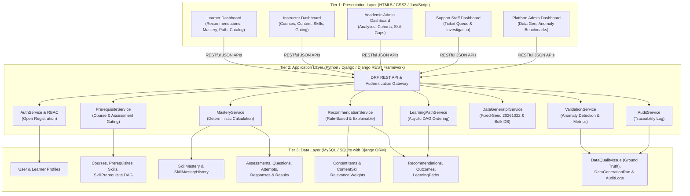

# System Architecture Documentation
## Personalized Learning Recommendation System

### 1. Architectural Overview

The **Personalized Learning Recommendation System** is built on an enterprise **Three-Tier Architecture** that enforces strict separation of concerns, role-based access control (RBAC), deterministic recommendation generation, and backend prerequisite gating.

---

### 2. Tier 1: Presentation Layer
- **Technologies**: Semantic HTML5, CSS3 Custom Properties Design System, Vanilla ES6+ JavaScript.
- **Protocol**: Exclusively consumes Tier 2 via HTTP REST JSON APIs (`fetch` with CSRF protection). Direct database communication from the presentation tier is strictly prohibited.
- **Components**:
  1. **Authentication Views**: Login (`/login/`), Registration (`/register/`).
  2. **Role Dashboards**:
     - *Learner*: Personalized recommendation cards with reason badges, real-time mastery meters, interactive assessment runner modal, learning path milestone viewer, locked course catalog with prerequisite tooltips, support request modal.
     - *Instructor*: Course creator, skill DAG configurator, content-to-skill mapper with weights, assessment question bank builder, at-risk learner alert monitor.
     - *Academic Admin*: Cohort analytics, enrollment vs completion rates, curriculum skill gap heatmaps, academic report exports.
     - *Support Staff*: Support ticket triaging, category filters, learner investigation modal, escalation workflow.
     - *Platform Admin*: Synthetic data generator control panel, live validation benchmark scorecard.

---

### 3. Tier 2: Application Layer (Django & DRF)
The application layer isolates business logic from views and controllers through a dedicated **Service Layer**:

- `AuthService`:
  - Registers users as `ACTIVE` immediately (no approval step).
  - Suspension enforcement at credential verification.
- `PrerequisiteService`:
  - Evaluates course eligibility on the backend.
  - Enforces completion of prerequisite courses, minimum skill mastery levels (e.g. $\ge 70\%$), and passing prerequisite gating assessments ($\ge 70\%$).
  - Detects circular dependencies (cycles) in the skill graph using depth-first search (DFS).
- `AssessmentService`:
  - Enforces server-side objective grading against question answer keys (never trusts scores submitted by clients).
  - Triggers atomic mastery calculation and enrollment progress updates.
- `MasteryService`:
  - Computes skill mastery using historical valid attempts:
    $$\text{Mastery} = \frac{\sum_{i=1}^{N} \text{Score}_i}{N}$$
  - Classifies learners into 4 configurable tiers:
    - Needs Improvement ($< 40\%$)
    - Developing ($40\% - 69\%$)
    - Proficient ($70\% - 84\%$)
    - Mastered ($\ge 85\%$)
  - Preserves an immutable chronological history in `SkillMasteryHistory` to guarantee temporal consistency and eliminate future leakage.
- `RecommendationService`:
  - Rule-based, deterministic, explainable ranking engine.
  - Integrates skill gap weights, difficulty alignment, prerequisite eligibility, and recency of failed assessments.
  - Emits standardized reason codes (`SKILL_GAP`, `PREREQUISITES_MET`, `COLD_START`, `ASSESSMENT_FAILED`, `DIFFICULTY_MATCH`, etc.) and natural language explanations.
- `DataGeneratorService`:
  - Generates parameterized datasets (Starter: 100 learners, 1k attempts; Full: 10k learners, 500k attempts) using fixed seed `20261022` and bulk database operations.
  - Injects 5 labeled ground-truth anomaly scenarios into isolated validation structures.
- `ValidationService`:
  - Runs automated integrity checks (PK uniqueness, FK referential integrity, date ordering, graph acyclicity, Precision@3, Recall@3, and anomaly detection rate).

---

### 4. Tier 3: Data Layer (Django ORM & MySQL/SQLite)
- **Engine**: MySQL Server 8.0 (with production connection pooling and strict SQL modes) and SQLite 3 for local zero-dependency testing.
- **Entity Identification Scheme**:
  - `Learner`: `LRN-000001`
  - `Course`: `CRS-000001`
  - `Skill`: `SKL-000001`
  - `Content`: `CNT-000001`
  - `Attempt`: `ATT-<learner_id>-000001`
  - `Learning Path`: `PATH-2026-000001`
  - `Recommendation`: `REC-000001`
  - `Assessment`: `ASM-000001`
  - `Support Ticket`: `TCK-000001`
- **Integrity**: Enforced foreign keys with `CASCADE` and `SET_NULL`, unique compound constraints on bridge models (`(course, prerequisite_course)`, `(content_item, skill)`, `(learner, skill)`), and B-Tree database indexes on query paths.
